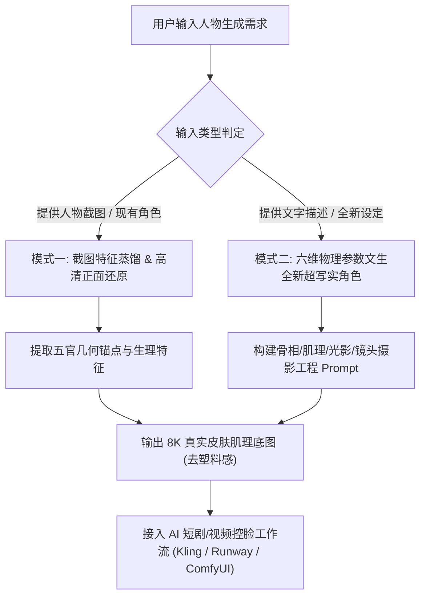
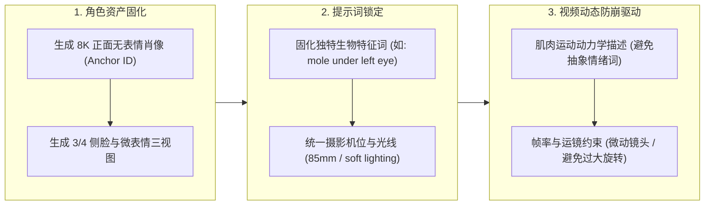

# 超写实人物与 AI 视频角色工程指南 (Photorealistic Character Skill)

## 1. 概述 (Overview)

超写实人像生成的核心底层逻辑是**“以物理光学、解剖微纹理与摄影器材参数取代主观形容词”**。
AI 生成人脸“塑料感、容易崩、五官失真、恐怖谷效应”的根本原因在于：过度对称性、缺乏微观皮肤瑕疵、缺失次表面散射（SSS）以及光影不符合真实镜头光学物理。

本 Skill 提供两套标准化工业级生成工作流：
1. **模式一（截图还原/垫图复刻）**：从任意影视片段、短剧截图或真实照片中提取面部特征锚点，输出零畸变、高保真、8K 皮肤质感的标准正面肖像（用于 LoRA 训练、FaceID 注入与图生视频底图）。
2. **模式二（文生全新超写实角色）**：通过年龄、职业、骨相、皮肤瑕疵、微表情、镜头与光影的多维物理参数，从零构建极具生命力的真实人物形象（适用于 AI 短剧、商业广告、虚拟博主等）。

---

## 2. 适用场景与模式路由 (When to Use)



### 适用场景：
- **AI 短剧与微电影制作**：主配角定妆照、角色库搭建、多镜头人脸一致性保持。
- **影视与短剧名场面复刻**：上传截图高度还原演员长相与神态，重构高分辨率正脸。
- **商业广告与品牌代言人**：拒绝网红脸与 AI 假人感，生成具有真实毛孔、汗毛与微瑕疵的高级质感人像。
- **虚拟博主与数字人 IP**：构建稳定、生动且支持多角度渲染的虚拟人物资产。

---

## 3. 六维超写实物理提示词架构 (The 6-Dimensional Realism Framework)

超写实人像的 Prompt 结构必须严格按照以下六个物理维度构建，严禁使用“beautiful, perfect face, smooth skin, masterpiece”等引发磨皮塑料感的主观词：

```
[主体解剖特征与年龄] + [皮肤微观肌理与微瑕疵] + [眼球/眼神光/微表情] + [发型与发丝边缘物理特性] + [摄影器材与镜头光学参数] + [光影物理与次表面散射]
```

| 维度 | 核心控制参数 | 英文专业提示词 (Prompt Tokens) | 解决的痛点 |
| :--- | :--- | :--- | :--- |
| **1. 解剖与年龄** | 年龄、族裔骨相、面部轮廓比例、颈部与锁骨结构 | `[age]-year-old [ethnicity] [gender], distinct facial bone structure, natural asymmetry, authentic facial features` | 解决脸型千篇一律、AI 网红蛇精脸 |
| **2. 皮肤微肌理** | 真实毛孔、细微瑕疵、微血管、次表面散射 (SSS) | `visible skin pores, fine peach fuzz (vellus hair), subtle skin texture, micro-imperfections, uneven pigmentation, subsurface scattering` | 彻底消除塑料磨皮感、死白橡胶感 |
| **3. 眼神与微表情** | 视线对焦、虹膜纹理、巩膜红血丝、泪膜反光、非僵硬肌肉 | `intricate iris pattern, natural catchlights in pupils, moist sclera with subtle micro-veins, relaxed facial micro-expressions` | 解决眼神呆滞、死鱼眼、对眼、假笑 |
| **4. 毛发物理学** | 独立发丝、边缘碎发、毛囊生长方向、自然毛躁 | `individual hair strands, natural hairline, stray flyaway hairs, realistic hair sheen, unpolished organic hair texture` | 解决“头盔假发”、色块化头发 |
| **5. 镜头光学参数** | 人像黄金焦段、大光圈虚化、传感器色彩、RAW 格式 | `shot on 85mm f/1.8 prime lens, Sony A7R V / Hasselblad H6D-100c, shallow depth of field, creamy background bokeh, 8k resolution, raw photo` | 消除 AI 渲染感，引入真实光学景深 |
| **6. 光影与质感** | 伦勃朗光、漫射柔光、边缘轮廓光、真实光影衰减 | `soft diffused natural window light, subtle Rembrandt lighting, cinematic rim lighting highlighting cheek contours, volumetric shadows` | 解决无立体感、浮夸反光、面部扁平 |

---

## 4. 模式一：截图还原·高清写实正面人像 (Mode 1: Screenshot to HD Frontal Restoration)

### 4.1 核心操作流程
1. **面部特征蒸馏**：提取截图中的 5 项核心面部生物特征（眼睛形状/眼距、鼻梁/鼻翼弧度、唇形与厚度、下颌与下巴曲线、特色标识如痣/雀斑/酒窝）。
2. **正面肖像重构 (Frontal Realignment)**：无论原图是侧脸、仰角还是被遮挡，通过提示词强制转换为标准**平视正面近景肖像 (Eye-level frontal close-up portrait)**。
3. **注入超写实皮肤与摄影底色**：剥离原图的压缩噪点或低画质，注入 85mm 镜头、可见毛孔、次表面散射等真实光学属性。

### 4.2 模式一通用 Prompt 模板

```markdown
**Prompt (模式一·正面还原):**
A raw, hyper-realistic 8k studio frontal passport-grade portrait of a [性别/族裔/年龄段], perfectly matching the facial features, bone structure, eye shape, nose contour, and facial proportions of the reference image. Looking directly at the camera at eye level, neutral relaxed micro-expression. Intricate skin details with visible micro-pores, fine vellus hair (peach fuzz), subtle skin texture, natural asymmetry, authentic subsurface scattering, unretouched raw photo. Natural catchlights in pupils, distinct iris texture. Shot on 85mm f/1.4 lens, Sony A7R V, soft diffused beauty-dish studio lighting with subtle rim light, ultra-sharp focus on the eyes, cinematic color fidelity, 8k UHD.

**Negative Prompt (负面抑制词 - 适用于 SD/WebUI/ComfyUI):**
plastic skin, airbrushed, CGI, 3D render, cartoon, anime, illustration, beauty filter, smooth skin, over-saturated, blurry, mutated eyes, cross-eyed, deformed iris, extra limbs, bad anatomy, duplicate, artificial gloss, excessive makeup.
```

---

## 5. 模式二：文生全新超写实角色 (Mode 2: Text-to-Lifelike Character Generation)

### 5.1 提示词组装公式
根据角色在短剧/广告中的人设定位，按以下配方组装：

```
[角色身份/年龄/国籍] + [发型与发色细节] + [五官与骨相特征] + [皮肤质感与特定瑕疵] + [服装与道具] + [拍摄环境与光影] + [摄影设备与画质指令]
```

### 5.2 五大经典影视/短剧角色实战示例 (基于高品质真实参考标准)

#### 案例 1：东亚清纯短发少女（短剧女主/初恋设定）
> **中文描述**：20岁东亚年轻女性，齐刘海齐肩短发（Bob头），黄色贴身圆领上衣，纯净自然的素颜妆感，细腻可见的微毛孔与鼻翼自然光泽，柔和室内漫射光，平视特写。
>
> **Standard Prompt:**
> `A raw, hyper-realistic close-up portrait of a 20-year-old East Asian young woman with blunt straight bangs and a clean bob haircut. Wearing a pale yellow fitted high-neck mock-top. Natural authentic bare-skin texture with visible micro-pores, fine peach fuzz, subtle skin sheen on the nose bridge, slight natural asymmetry. Dark brown eyes with intricate iris details and soft catchlights, relaxed subtle expression. Shot on 85mm f/1.8 lens, Sony Alpha A7R V, soft diffused natural studio lighting, neutral clean background, 8k resolution, raw photo, unretouched, zero beauty filter.`

#### 案例 2：混血复古少女（影视女主/时尚博主设定）
> **中文描述**：22岁欧美/混血年轻女子，深棕色微卷长发搭配黑色丝缎蝴蝶结发饰，浅绿色/淡褐色瞳孔，鼻梁带轻微自然雀斑，粉嫩自然唇纹，清晰锁骨线，柔和影棚肖像光。
>
> **Standard Prompt:**
> `A high-end cinematic photorealistic portrait of a 22-year-old Caucasian young woman with dark brown wavy long hair styled with a black satin ribbon bow clip. Hazel-green eyes looking into the camera, subtle natural freckles across the nose bridge and cheeks, natural lip texture with fine creases. Delicate collarbone visible in a black sleeveless top. Shot on Hasselblad H6D-100c, 105mm portrait lens, f/2.0 aperture, soft window daylight combined with gentle key light, authentic subsurface scattering, creamy blurred background, 8k, raw color grading.`

#### 案例 3：港风/美式复古氛围少女（短剧个性女主/女二设定）
> **中文描述**：24岁深发少女，蓬松微卷刘海卷发，佩戴大银色圈状耳环，侧逆光（黄金时刻窗边光线），面部带有细微汗光与湿润感，极具生命力的高级野生美。
>
> **Standard Prompt:**
> `A hyper-realistic cinematic portrait of a 24-year-old woman with voluminous messy dark curly hair and soft fringe bangs, wearing large silver hoop earrings. Golden hour natural sunlight streaming from a side window, creating warm rim lighting on hair strands and cheekbones. Authentic skin texture with dewy moisture, visible skin grain, subtle peach fuzz, natural lip shine. Deep brown expressive eyes with golden reflection. Shot on ARRI Alexa Mini, 50mm f/1.4 lens, cinematic film grain, raw documentary aesthetic, masterclass lighting.`

#### 案例 4：雅痞中年大叔（商战剧男主/成熟精英/父亲设定）
> **中文描述**：48岁白人中年男性，略显凌乱的棕色短发，成熟浓密的八字胡，自然的额头抬头纹、鱼尾纹与法令纹，眼神深邃沧桑，白色开领衬衫，经典影棚人像。
>
> **Standard Prompt:**
> `A raw, hyper-realistic character portrait of a 48-year-old Caucasian middle-aged man with tousled wavy brown hair and a thick well-groomed chevron mustache. Weathered masculine face with authentic aging details: natural forehead wrinkles, crow's feet around warm blue-grey eyes, realistic laugh lines, and defined neck tendons. Wearing an unbuttoned crisp white collar shirt. Shot on Canon EOS R5, 85mm f/1.4 lens, Rembrandt studio portrait lighting with soft shadow gradation, sharp focus on iris and skin pores, 8k UHD, candid documentary photograph.`

#### 案例 5：沧桑写实劳动者/底层人物（现实主义短剧/电影质感设定）
> **中文描述**：55岁东亚中年男性环卫工人，短寸发，饱经风霜的深色粗糙皮肤，深邃的额头皱纹与眼角纹，身穿带反光条的橙色工作服，内搭灰色打底衫，背景为雨后虚化的城市街道。
>
> **Standard Prompt:**
> `A powerful hyper-realistic documentary portrait of a 55-year-old East Asian male sanitation worker. Rugged weathered tan skin with deep life-etched forehead wrinkles, pronounced crow's feet, natural sunspots, and honest textured skin. Short salt-and-pepper cropped hair. Wearing a worn orange reflective sanitation uniform jacket over a heather grey crewneck. Sincere, grounded gaze looking into the lens. Shot on Nikon Z9, 85mm f/1.8 lens, overcast diffused daylight on a rainy city street with shallow depth of field, 8k raw photo, National Geographic style.`

---

## 6. AI 视频与短剧防崩一致性工作流 (AI Video Face Consistency Pipeline)

为确保静态生成的超写实人脸在可灵 (Kling)、即梦 (Jimeng)、Runway Gen-3、海螺 (Minimax)、Wan 2.1 或 ComfyUI 中做动作时不崩坏、不走样，必须遵循以下工程化流程：



### 6.1 动态描述的“面部微肌肉导演法”
在视频生成提示词中，**禁止使用抽象情绪词**（如“she is very sad”），必须使用**生理肌肉微动指令**：
- ❌ 错误（易崩）：`The woman cries sadly and looks around quickly.`
- ✅ 正确（写实稳定）：`A subtle slow-motion micro-expression: her lower eyelids tense slightly, a single tear wells in the corner of her eye, her bottom lip quivers delicately while her gaze remains locked forward. Shot on 85mm lens, stable slow cinematic push-in.`

### 6.2 视频生成防崩负面关键词组合
在支持负向提示词的视频平台中，必须加入以下防崩字典：
```
glitch face, morphing facial features, distorted eyes, cross-eye, double pupils, vibrating eyelashes, plastic mask, rubber skin, melting skin, unnatural head spin, warped jawline.
```

---

## 7. 常见误区与避坑指南 (Common Pitfalls & Fixes)

| 典型错误现象 | 根本原因 | 阿里云/专业级修正方案 |
| :--- | :--- | :--- |
| **人脸像塑料娃娃/假人** | 滥用了 `beautiful, gorgeous, smooth skin, porcelain face` 等修饰词 | 立即删除所有主观美化词，强制加入 `visible micro-pores, fine vellus hair, subtle micro-imperfections, unretouched raw photo` |
| **五官对称得像假面具** | AI 默认倾向生成对称几何人脸 | 提示词加入 `natural asymmetry, authentic facial features, slight natural head tilt` |
| **头发像塑料头盔或油漆块** | 缺少发丝微观几何描述 | 加入 `individual hair strands, fine stray flyaway hairs, realistic hair sheen` |
| **视频一动脸就变形换脸** | 底图角度过偏，或视频提示词动作幅度超出模型负荷 | 底图一律使用标准平视正面 85mm 肖像，视频运镜首选 `slow subtle zoom / gentle pan`，限制单次镜头内头部旋转在 30 度以内 |
| **眼神发空死板 (恐怖谷)** | 缺少光源反射与虹膜细节 | 明确指定 `natural catchlights in pupils, distinct iris pattern, moist sclera` |

---

## 8. 快速自检清单 (Verification Checklist)

在交付或生成超写实人物 Prompt 前，逐项核对：
- [ ] **六维完整性**：是否包含解剖结构、微观皮肤肌理、眼睛反光、发丝边缘、镜头光圈、物理光影？
- [ ] **零塑料词**：是否彻底排除了 `smooth skin, perfect, flawless, anime, 3d render`？
- [ ] **物理可信度**：是否有 `subsurface scattering (次表面散射)`、`visible pores (可见毛孔)`、`peach fuzz (绒毛)` 等微观关键词？
- [ ] **镜头约束**：是否指定了具体焦段（如 `85mm`, `105mm`）和相机级别（如 `Sony A7R V`, `Hasselblad`, `ARRI`）？
- [ ] **短剧一致性**：特征标记（如痣、骨相、特定发色）是否能在后续镜头中无歧义复用？
