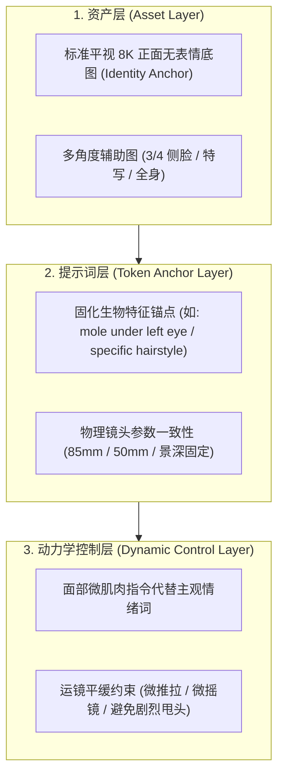

# AI 短剧人脸一致性与防崩实战工作流 (AI Video Consistency Workflow)

本文档面向 **AI 短剧、影视片段复刻、商业广告** 制作全流程，解析如何在视频生成工具（可灵 Kling、即梦 Jimeng、Runway Gen-3、海螺 Minimax、Wan 2.1 与 ComfyUI）中保持人物长相绝对一致、动作不崩脸、画质不退化。

---

## 1. 人物一致性“三位一体”核心法则 (The Triad of Character Consistency)

在 AI 视频生成中，单一依靠图片或单一依靠提示词都容易崩坏，必须结合：

---

## 2. 主流 AI 视频平台实战控脸指南

### 2.1 可灵 (Kling 1.5 / 2.0)
- **图生视频 (Image-to-Video)**：
  - 首帧使用本 Skill 生成的 **85mm 正面超写实底图**。
  - **创意相关性 (Creativity/Relevance)**：设置为 `0.4 ~ 0.5`（过高会导致面部重构变形，过低会导致动作僵硬）。
  - **视频提示词结构**：`[主体微动作] + [微表情肌肉变化] + [摄影机运镜指令] + [光影延续]`。
  - **示例**：
    > `The woman slowly blinks, looking slightly downward with a thoughtful micro-expression, breathing subtly, shot on 85mm lens, smooth slow cinematic push-in, soft consistent studio lighting.`

### 2.2 即梦 (Jimeng / Seedance)
- **角色保持与画风控制**：
  - 开启“角色参考”功能，上传正面肖像图作为主参考。
  - 在生成视频时，加入负向词：`塑料脸, 假人, 五官变形, 眼睛变异, 面部撕裂, 模糊, 卡顿`。

### 2.3 Runway Gen-3 Alpha / Turbo
- **Motion Brush (运动笔刷)**：
  - 使用运动笔刷仅涂抹人物背景或眼球、嘴唇等微动区域，**面部轮廓与鼻梁骨相禁止涂抹强运动**。
  - 镜头控制使用固定的 `Camera Move: Fixed / Gentle Zoom In (0.5)`。

### 2.4 ComfyUI (Flux + PuLID / InstantID + AnimateDiff / Wan 2.1)
- **节点链条推荐**：
  - `Flux.1-dev` (基础底模) + `PuLID-Flux` (人脸保真度权重设置 `0.75-0.85`)
  - 配合 `Realism_LoRA` (权重 `0.5-0.6`) 注入皮肤微孔与胶片颗粒。
  - 面部细修使用 `FaceDetailer` (BBOX: face, SAM: vit_b) 进行 1.5 倍高清面部重绘（Denoise 设置在 `0.25-0.35` 之间，防止换脸）。

---

## 3. 短剧分镜动作防崩对照表 (Safe Motion Prompting)

| 剧情常见场景 | ❌ 高危 Prompt (极易崩脸/换脸) | ✅ 安全超写实 Prompt (极度稳定) |
| :--- | :--- | :--- |
| **女主哭泣** | `She cries loudly and weeps with tears rolling down.` | `A slow-motion subtle emotional moment: her lower eyelids moisten, a single tear forms at the corner of her right eye, subtle lip tremble, head stays facing the camera, 85mm lens.` |
| **男主转头看人** | `He quickly turns his head 180 degrees to look back.` | `He slowly turns his head 20 degrees to the left, his eyes shift smoothly to the left edge of frame, gentle focus shift, shallow depth of field.` |
| **说话对话** | `The person talks happily and moves their mouth a lot.` | `Natural speech cadence: gentle mouth articulation, realistic jaw movement, maintaining eye contact, subtle head nod, stable framing.` |
| **受惊/震惊** | `Shocked face, screaming and opening mouth wide.` | `Subtle pupil dilation, sharp quick intake of breath causing slight chest rise, eyebrows subtly raising, maintaining facial structure.` |

---

## 4. 角色资产库构建规范 (Character Asset Bible)

在启动一部 AI 短剧前，为每一个主要角色建立**标准资产卡**：

1. **ID_Portrait_Front.png**：标准正面 85mm 8K 证件级肖像（无大表情、自然平视）。
2. **ID_Portrait_34_Left.png**：向左偏转 30 度的 3/4 侧脸肖像。
3. **ID_Portrait_34_Right.png**：向右偏转 30 度的 3/4 侧脸肖像。
4. **ID_FullBody.png**：包含常服与鞋履的全身站姿设定图。
5. **Token_Signature**：角色的永久特征锚点文本（如：`a distinct small mole 2mm below the left lower eyelid, natural dark brown hair with straight bangs, defined jawline`）。
