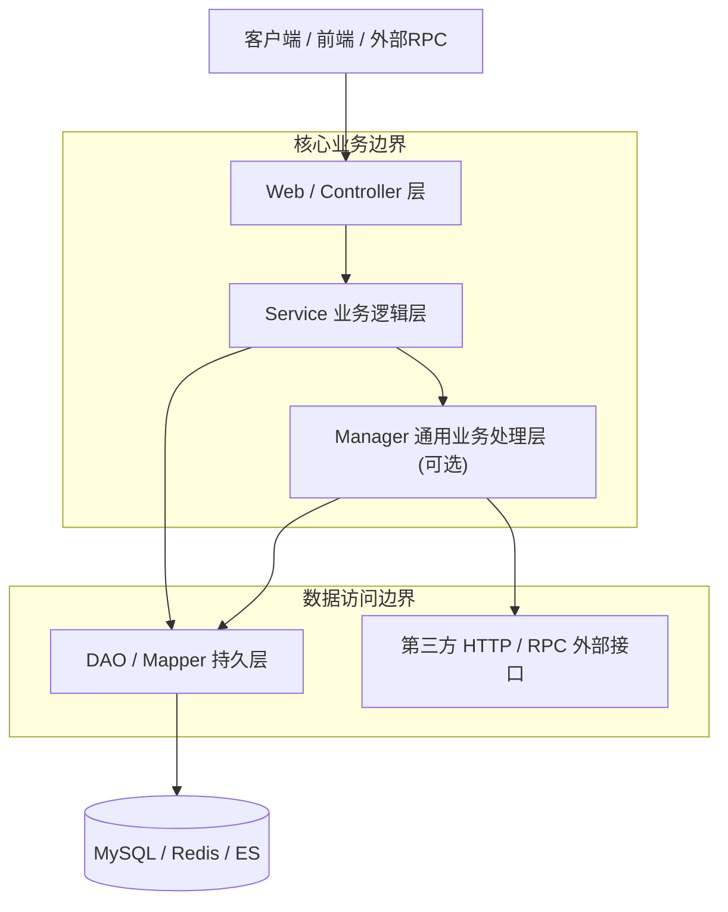

# 阿里巴巴 Java 开发规范与工程铁律 (Alibaba Java Standards)

<SUBAGENT-STOP>
If you were dispatched as a subagent to execute a specific task, apply these standards directly to all Java code generated or modified.
</SUBAGENT-STOP>

<EXTREMELY-IMPORTANT>
**字面违规即实质违规 (Violating the letter of the rules is violating the spirit of the rules).**

在 Java 工程开发与重构中，**严禁**以“这只是 Demo”、“稍后重构”、“单线程场景不会出错”、“本地测试没问题”为由妥协编码规范。
一旦触发红旗指标（Red Flags），必须立即原地纠正，不得带病合并代码。
</EXTREMELY-IMPORTANT>

---

## 1. 核心定位 (Overview)

本技能将《阿里巴巴 Java 开发手册》（泰山版/黄山版/嵩山版）精髓与 Superpower 纪律化工程范式融合，针对 Java 开发中的**高危陷阱、并发隐患、内存泄漏、数据精度丢失、架构分层混乱**提供强制性约束与可落地的正向代码契约（Positive Code Contracts）。

---

## 2. 红旗预警：立即停止并重构 (Red Flags - STOP and Refactor)

只要在代码中出现以下任一特征，意味着规范已失守，**必须立即停止并原地修正**：

| 红旗特征 (Red Flag) | 致命隐患 | 唯一正确替代方案 |
| :--- | :--- | :--- |
| `Executors.newFixedThreadPool(...)` / `newCachedThreadPool(...)` | 允许无界队列或无限线程，高并发下导致 **OOM (OutOfMemoryError)** | 手动 `new ThreadPoolExecutor(...)`，显式指定有界队列与拒绝策略 |
| `SimpleDateFormat` 作为共享/静态变量 | 内部共享 Calendar 实例，多线程格式化导致**日期错乱或并发异常** | Java 8+ `DateTimeFormatter` 或本地 `ThreadLocal<SimpleDateFormat>` |
| `double` / `float` 直接进行金额计算或构造 `BigDecimal(double)` | 浮点数二进制近似导致**资金/金额精度丢失** | 必须使用 `BigDecimal(String)` 或 `BigDecimal.valueOf(double)` |
| `Arrays.asList(array)` 后执行 `add()` / `remove()` | 返回不可变内部类适配器，运行时抛出 `UnsupportedOperationException` | `new ArrayList<>(Arrays.asList(array))` 或 Java 9+ `List.of()` 防御复制 |
| `ThreadLocal` 变量在任务结束后未 `remove()` | 线程池复用线程导致**业务数据串号污染**与 `ClassLoader` 内存泄漏 | 必须在 `finally` 块中执行 `threadLocal.remove()` |
| POJO / RPC 传输对象布尔字段命名为 `isSuccess` | 部分序列化框架（如 Jackson/Fastjson/RPC）反射会将 getter 识别为 `success` 导致**反序列化属性丢失** | 字段命名为 `success`，避免 `is` 前缀 |
| Controller 直接返回实体类 `DO` 或接收 `DO` 作为入参 | 破坏分层隔离，导致**敏感字段暴露 (IDOR)** 或数据模型层层耦合 | 入参使用 `DTO/Query`，出参使用统一响应 `Result<VO>` |
| `catch (Exception e)` 中使用 `e.printStackTrace()` 或静默忽略 | 吞掉异常堆栈，导致**生产故障无法排查与追踪** | 使用 `log.error("context message, param: {}", p, e)` 记录完整堆栈并抛出自定义异常 |
| SQL 查询中使用 `SELECT *` | 无法利用覆盖索引，网络 I/O 浪费，表结构变更引发反序列化故障 | 必须显式声明所需的字段列表（如 `SELECT id, name, status`） |
| 单测依赖外部真实环境或缺少断言 | 单测不可重复、不稳定、无法融入 CI/CD 流水线 | 遵循 **AIR 原则** 与 **BCDE 边界测试**，使用 Mockito 隔离外部依赖 |

---

## 3. 防借口反制心智表 (Rationalization Table)

| 侥幸想法 / 狡辩借口 (Rationalization) | 客观现实与致命后果 (Reality) |
| :--- | :--- |
| “这只是内部工具/测试代码，用 `Executors` 快速创建就行。” | 内部工具会演变为核心服务，测试代码会被复制到生产环境。从第一行代码就使用标准线程池。 |
| “这个字段只有内部使用，Controller 直接把 DO 返回出去最省事。” | 破坏分层契约是架构腐化的开端；一旦数据库增加密码/密钥字段，会造成严重安全漏洞。 |
| “单线程环境用 `SimpleDateFormat` 没风险，没必要改写。” | 代码会被他人重构或放入并发流/多线程任务中，埋下定时炸弹。必须统一使用 `java.time.*`。 |
| “直接 `catch(Exception e)` 打印一下日志，程序不崩就行。” | 吞异常会导致分布式事务无法回滚、上游拿不到错误码、监控报警失效。 |
| “金额就几毛几分钱，`double` 算一下误差可以忽略。” | 涉及金钱与计费无小事，浮点累加会产生不可对账的坏账。强制使用 `BigDecimal`。 |
| “单测太耗时间了，我本地用 Postman 手动调通了。” | 手动验证无法自动化沉淀。无单测的代码无法保证后续重构的安全性，严禁合并。 |

---

## 4. 核心工程架构与分层契约 (Architectural Contracts)



### 领域模型流转契约
- **DO (Data Object)**：与数据库表结构 1:1 映射，**严禁逃出 DAO/Service 层**。
- **DTO (Data Transfer Object)**：Service 层向外传输或接收的业务数据对象。
- **VO (View Object)**：Web 层向客户端输出的展示对象，脱敏且仅包含展示所需字段。
- **Query / Param**：入参封装对象，必须配合 JSR-303 (`@Valid`, `@NotNull`) 进行前置校验。
- **Result~T~ 统一响应**：Controller 必须统一返回 `Result~T~`，包含 `code`, `message`, `data`, `traceId`。

---

## 5. 高频规约深度速查 (High-Frequency Discipline Matrix)

```
===================================================================================
1. 命名与常量规约 (Naming & Constants)
   - 类名: UpperCamelCase (如 OrderServiceImpl)
   - 接口与实现: 接口 OrderService，实现类 OrderServiceImpl
   - 方法/变量: lowerCamelCase (如 queryOrderList)
   - 常量: 全部大写 + 下划线 (如 MAX_STOCK_COUNT)，long 型常量后必须使用大写 'L' (如 1000L)
   - 数组定义: 类型[] 数组名 (如 String[] args，严禁 String args[])
   - 抽象类: Abstract/Base 开头；异常类: Exception 结尾；测试类: Test 结尾
   - 枚举类: Enum 结尾，成员名全大写 (如 OrderStatusEnum.PAID)

2. OOP 与数据类型 (OOP & Data Types)
   - 浮点数计算: 强制使用 BigDecimal(String)，严禁 new BigDecimal(double)
   - 基础类型 vs 包装类型: POJO 属性必须使用包装类型 (防止默认值掩盖 null)；RPC 参数/返回值强制包装类型；局部变量优先基本类型
   - 集合/数组强转: 严禁将 Object[] 强转为具体类型数组；集合使用 toArray(new String[0])
   - equals 契约: 重写 equals 必须重写 hashCode；常量/字面量调用 equals (如 "SUCCESS".equals(status))

3. 并发编程与线程池 (Concurrency & Threads)
   - 线程池创建: 严禁 Executors，必须 ThreadPoolExecutor 显式指定参数 (Core, Max, Queue, Factory, Handler)
   - 线程命名: ThreadFactory 必须自定义具有业务含义的线程名称
   - ThreadLocal: 必须在 finally 块中调用 remove()
   - 计数器: 高并发场景优先使用 LongAdder，替代 AtomicLong

4. 集合与流操作 (Collections & Streams)
   - 集合初始化: 指定初始容量，HashMap 容量 = (需要存储的元素个数 / 0.75F + 1)
   - subList 陷阱: subList 返回的是内部子列表视图，不可强转为 ArrayList，对原列表修改会导致 subList 抛 ConcurrentModificationException
   - toMap 陷阱: Collectors.toMap 必须显式提供 (v1, v2) -> v1 冲突合并函数，且 value 不可为 null
   - 遍历删除: 严禁在 foreach 循环中调用 list.remove()，必须使用 Iterator.remove()

5. 异常处理与日志规范 (Exceptions & Logs)
   - 异常捕获: 严禁捕获 Throwable；严禁捕获后不处理；严禁吞掉原始异常栈
   - 事务回滚: @Transactional 必须显式声明 rollbackFor = Exception.class
   - 日志门面: 强制使用 SLF4J 门面，严禁 System.out / e.printStackTrace()
   - 日志占位符: 使用 log.info("User id: {}, name: {}", id, name)，严禁字符串 '+' 拼接
   - 敏感信息: 手机号、身份证、银行卡、密码必须在日志和接口中进行脱敏打印

6. MySQL 与持久层规约 (MySQL & ORM)
   - 建表规范: 字段小写下划线；主键 bigint unsigned；必须包含 id, gmt_create, gmt_modified
   - 索引设计: 避免过多索引 (单表不超过 6 个)；组合索引遵循最左前缀原则
   - SQL 编写: 严禁 SELECT *；分页查询必须保证排序字段有索引；IN 条件数量严格限制 (如不超过 500)
===================================================================================
```

---

## 6. 模块化支撑文件索引 (Modular References)

当遇到特定领域的深入实现、边界细节或模板代码时，查阅对应的参考文档：

- 📐 **[01-oop-and-naming.md](references/01-oop-and-naming.md)**：POJO 布尔陷阱、BigDecimal 运算、包装类与序列化契约。
- ⚡ **[02-concurrency-and-threads.md](references/02-concurrency-and-threads.md)**：生产级 ThreadPoolExecutor 模板、ThreadLocal 防泄漏、锁机制与并发容器。
- 📦 **[03-collections-and-streams.md](references/03-collections-and-streams.md)**：集合容量计算、toMap/subList/asList 避坑、并行流安全性。
- 🛡️ **[04-exceptions-and-logs.md](references/04-exceptions-and-logs.md)**：统一错误码体系、全局异常处理、MDC 链路追踪与日志脱敏规范。
- 🗄️ **[05-database-and-sql.md](references/05-database-and-sql.md)**：MySQL 生产建表 DDL、索引失效场景、MyBatis 防注入与批量操作最佳实践。
- 🏗️ **[06-engineering-architecture.md](references/06-engineering-architecture.md)**：Controller-Service-Manager-DAO 分层规范、MapStruct 高性能转换、统一响应体。

---

## 7. 零容忍质量门禁清单 (Zero-Tolerance Quality Checklist)

在交付任何 Java 代码变更或提交审核前，**必须逐项核对并全部满足**：

- [ ] **线程安全**：无 `Executors` 快捷工厂；线程池命名清晰、队列有界；`ThreadLocal` 均在 `finally` 块显式 `remove()`。
- [ ] **时间与金额**：无 `SimpleDateFormat`；无 `new Date()`；金额计算全部采用 `BigDecimal(String)` 或 `BigDecimal.valueOf()`。
- [ ] **集合健壮性**：`toMap()` 带有冲突处理；`Arrays.asList()` 结果未被修改；`HashMap` 预估容量已合理设置。
- [ ] **异常与日志**：无 `e.printStackTrace()` 或 `System.out`；异常未被静默忽略；`@Transactional` 显式指定 `rollbackFor = Exception.class`；日志采用占位符输出。
- [ ] **数据与安全**：SQL 无 `SELECT *`；参数全部采用参数化绑定（MyBatis `#{}`，严禁 `${}` 拼接）；敏感数据已脱敏。
- [ ] **分层与命名**：POJO 属性为包装类型且布尔属性无 `is` 前缀；Controller 未直接暴露 `DO`；统一返回 `Result~T~`。
- [ ] **单元测试 (AIR)**：核心业务逻辑具备自动化单测，覆盖正常分支与异常边界（BCDE 原则），外部依赖全部 Mock。
