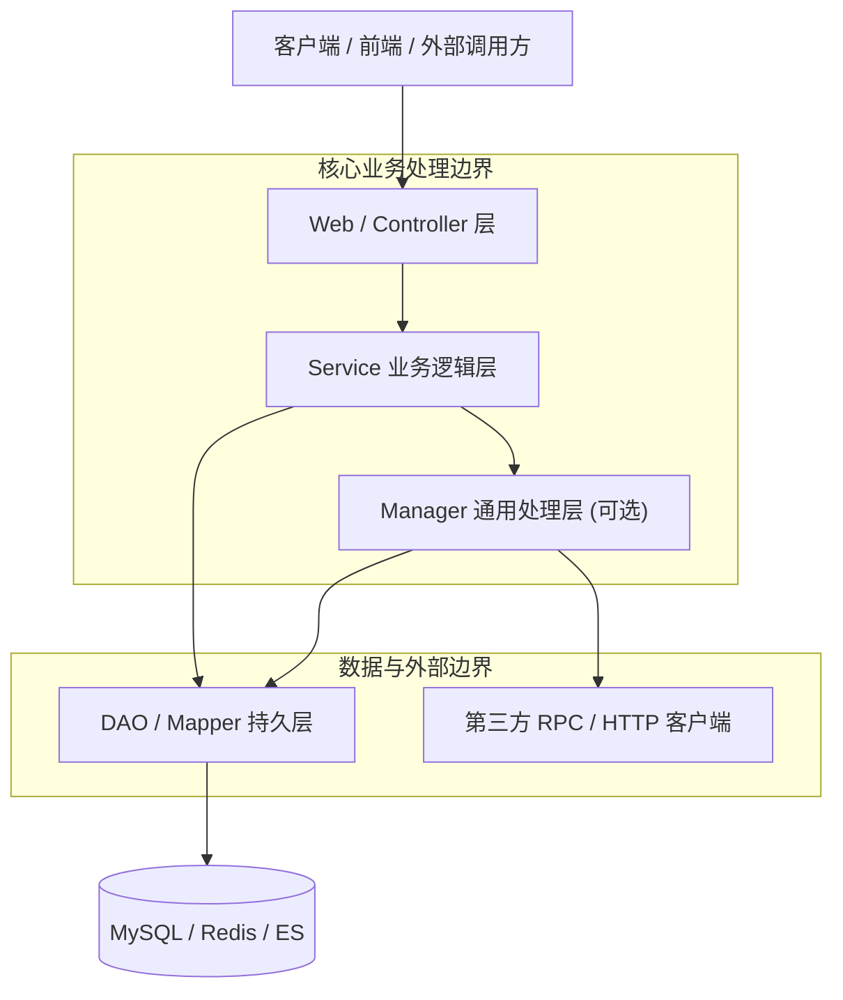

# 06 - 工程分层与领域模型规约 (Architecture & Layers)

## 1. 经典工程分层模型 (Engineering Layering)



### 1.1 各层职责与边界约束
| 分层 | 核心职责 | 绝对禁忌 (Red Flags) |
| :--- | :--- | :--- |
| **Web / Controller** | 参数前置校验 (`@Valid`)、路由分发、封装统一响应 `Result<VO>` | **严禁编写复杂业务逻辑**；严禁直接调用 DAO；严禁直接返回 `DO` 实体 |
| **Service** | 核心业务流程编排、事务边界定义、业务异常抛出 | 严禁直接接收 HTTP 原生请求/响应对象 (`HttpServletRequest`) |
| **Manager (可选)** | 通用业务下沉、多 DAO 复杂组合、第三方 RPC / HTTP 服务聚合封装、通用缓存编排 | 保持与具体上层业务解耦 |
| **DAO / Mapper** | 数据持久化 CRUD、纯 SQL 与数据对象映射 | 严禁编写业务判断逻辑；仅操作 `DO` 数据对象 |

---

## 2. 领域模型命名与流转契约 (Domain Models)

```
+-------------------------------------------------------------------------+
| [Client]  ---> (Query/DTO) ---> [Controller] ---> (DTO/BO) ---> [Service] |
|                                                                    |     |
| [Client]  <---   (VO)    <---   [Result<VO>] <--- (DTO/BO) <---+     |
|                                                                    |     |
|                                                                [Manager] |
|                                                                    |     |
|                                                                 (DO)     |
|                                                                    v     |
|                                                                 [DAO]    |
+-------------------------------------------------------------------------+
```

1. **DO (Data Object)**：与数据库表结构完全 1:1 对应的持久化对象。**作用域仅限 DAO 与 Service/Manager 内部，严禁逃逸至 Web 层**。
2. **DTO (Data Transfer Object)**：用于远程调用或跨层传输的数据对象。
3. **VO (View Object)**：Web 层向客户端输出的展示数据对象。**必须经过字段脱敏，仅包含前端必需展示的数据**。
4. **BO (Business Object)**：复杂的业务实体对象，可封装多个 DTO/DO 的综合业务逻辑。
5. **Query / Param**：查询参数封装对象，必须配合参数校验注解使用。

---

## 3. 统一响应与异常处理契约 (Unified Response & Error Handling)

### 3.1 统一响应体 Result\<T\> 结构
```java
import lombok.Data;
import java.io.Serializable;

/**
 * 统一 API 响应包装类
 */
@Data
public class Result<T> implements Serializable {
    private static final long serialVersionUID = 1L;

    private Boolean success;
    private String code;
    private String message;
    private T data;
    private String traceId;
    private Long timestamp;

    public static <T> Result<T> success(T data) {
        Result<T> result = new Result<>();
        result.setSuccess(true);
        result.setCode("00000");
        result.setMessage("Success");
        result.setData(data);
        result.setTimestamp(System.currentTimeMillis());
        return result;
    }

    public static <T> Result<T> fail(String code, String message) {
        Result<T> result = new Result<>();
        result.setSuccess(false);
        result.setCode(code);
        result.setMessage(message);
        result.setTimestamp(System.currentTimeMillis());
        return result;
    }
}
```

### 3.2 全局异常拦截器 (@RestControllerAdvice)
```java
@Slf4j
@RestControllerAdvice
public class GlobalExceptionHandler {

    @ExceptionHandler(MethodArgumentNotValidException.class)
    public Result<Void> handleValidationException(MethodArgumentNotValidException e) {
        String errorMsg = e.getBindingResult().getFieldErrors().stream()
            .map(DefaultMessageSourceResolvable::getDefaultMessage)
            .collect(Collectors.joining("; "));
        log.warn("Parameter validation failed: {}", errorMsg);
        return Result.fail("PARAM_INVALID", errorMsg);
    }

    @ExceptionHandler(BizException.class)
    public Result<Void> handleBizException(BizException e) {
        log.warn("Business exception: code={}, msg={}", e.getCode(), e.getMessage());
        return Result.fail(e.getCode(), e.getMessage());
    }

    @ExceptionHandler(Exception.class)
    public Result<Void> handleSystemException(Exception e) {
        log.error("Unhandled system error", e);
        return Result.fail("SYS_ERROR", "System internal error, please try again later.");
    }
}
```

---

## 4. 对象转换：MapStruct vs BeanUtils

> [!IMPORTANT]
> **生产环境中，禁止使用 Apache / Spring 的 `BeanUtils.copyProperties` 进行大批量或复杂对象的属性拷贝。**
> - **原因**：`BeanUtils` 基于反射运行时匹配，性能开销大；当源对象与目标对象属性类型略有差异时会静默忽略或报错，导致排查极其困难。
> - **推荐方案**：采用 **MapStruct** 编译期生成代码，零运行时性能损耗，类型安全且支持自定义映射。

```java
import org.mapstruct.Mapper;
import org.mapstruct.Mapping;
import org.mapstruct.factory.Mappers;

@Mapper
public interface OrderConverter {
    OrderConverter INSTANCE = Mappers.getMapper(OrderConverter.class);

    @Mapping(target = "orderId", source = "id")
    @Mapping(target = "maskedPhone", expression = "java(DesensitizeUtil.maskMobile(doObj.getPhone()))")
    OrderVO toVO(OrderDO doObj);
}
```
