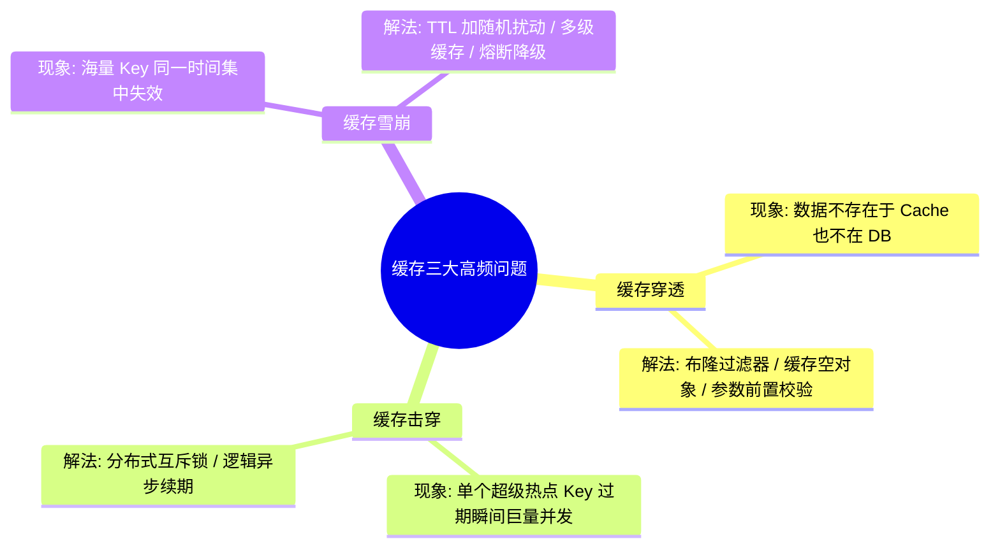

# Study Notes Writer (极简优雅学习笔记)

专注于构建**排版干净整洁、结构清晰严谨、具备高记忆留存率与行动转化力**的学习笔记与知识管理文档。

## 核心设计理念

1. **结构化分层（Visual & Logical Hierarchy）**：一眼看清核心脉络，拒绝密密麻麻的文字堆砌。
2. **费曼与直觉驱动（Intuition First）**：通俗类比打底，再深入底层原理与源码细节。
3. **主动回忆与自测闭环（Active Recall & Spaced Repetition）**：包含自测问题、核心卡片与避坑要点。
4. **图表协同（Diagrams & Tables）**：善用 Mermaid 思维导图/流程图与高维度对比表格。
5. **排版干净整洁（Clean Typography）**：严格遵循中英文排版规范、标准 Callout 提示框与优雅代码高亮。

---

## 核心工作流（5 步提炼法）

```
[原始材料/输入主题]
       │
       ▼
1. 提炼核心（TL;DR & 知识树）  ── 提取 1-3 句黄金概要 + Mermaid 脑图
       │
       ▼
2. 原理解析（费曼通俗解释）    ── 生活化类比 + 核心运作机制图解
       │
       ▼
3. 结构拆解（多维对比与示例）  ── 对比表格 + 极简最小可运行示例
       │
       ▼
4. 避坑指南（反模式与陷阱）    ── 常见误区 + 生产/实战踩坑分析
       │
       ▼
5. 复习自测（主动回忆与闪卡）  ── 康奈尔线索栏 + 3-5 道自测思考题
```

---

## 5 大经典笔记模式指南

根据不同的学习场景，加载专属结构模板：

| 学习场景 | 推荐模板 | 参考文档 | 适用场景 |
| :--- | :--- | :--- | :--- |
| **技术原理/源码/实战** | 技术深度笔记 | `references/tech-deep-dive-template.md` | 框架机制、后端架构、算法原理、工程实践 |
| **课程/讲座/系统性复习** | 康奈尔笔记法 | `references/cornell-notes-template.md` | 考前复习、体系化网课、结构化概念串联 |
| **晦涩复杂抽象概念** | 费曼学习法 | `references/feynman-technique-template.md` | 分布式共识、底层操作系统、量化数学原理 |
| **书籍/论文/长文精读** | 精读萃取笔记 | `references/book-paper-notes-template.md` | 技术书籍研读、前沿论文、行业深度研报 |
| **排版与可视化图表** | 排版与图表规范 | `references/typography-and-diagrams.md` | Mermaid 脑图设计、GitHub Alert 样式、LaTeX |

---

## 干净整洁排版硬性约束（MUST DO / MUST NOT DO）

### MUST DO
- **统一 YAML 元数据**：文档开头必须包含标题、日期、分类标签、难度与预备知识。
- **黄金一句话摘要（TL;DR）**：文档首屏给出 1~3 句话的核心精髓，降低阅读心智负担。
- **图表先行**：抽象逻辑必须配有 Mermaid 流程图/思维导图或对比表格。
- **中英文排版规范**：汉字与英文/数字之间保持 1 个半角空格（如 `使用 Python 3.12 进行并发处理`）。
- **标准 Callout**：善用 `> [!NOTE]`、`> [!TIP]`、`> [!IMPORTANT]`、`> [!WARNING]`。
- **自测闭环**：文末必须附带「3 分钟主动回忆自测题」或「费曼复述清单」。

### MUST NOT DO
- **严禁无分层的大段长文本**：单个段落不得超过 4 行，优先使用无序列表与加粗关键词。
- **严禁过度冗长无意义的代码**：代码示例仅展示最核心、最小可运行的逻辑，剔除干扰冗余。
- **严禁缺失定义直接使用黑话**：专业术语首次出现必须给出 1 句话简明定义或比喻。
- **严禁格式混乱**：标题层级严禁跳级（例如从 `#` 直接跳到 `###`）。

---

## 极简标准笔记示例（Technical Note Example）

```markdown
---
title: "Redis 缓存穿透、击穿、雪崩深度解析与防御方案"
date: "2026-08-25"
category: "后端架构 / 缓存"
tags: ["Redis", "缓存设计", "高并发", "性能优化"]
difficulty: "中级"
---

# Redis 缓存穿透、击穿、雪崩深度解析

> [!NOTE]
> **TL;DR 核心要点速览**：
> - **穿透**：查不存在的数据 $\rightarrow$ **布隆过滤器 / 空值缓存**
> - **击穿**：单热点 Key 过期瞬间并发压垮 DB $\rightarrow$ **互斥锁 (Mutex) / 逻辑不过期**
> - **雪崩**：大批 Key 同一时刻过期 $\rightarrow$ **随机过期时间 + 双层缓存 + 限流降级**



---

## 一、三者本质区别与对比

| 维度 | 缓存穿透 (Penetration) | 缓存击穿 (Breakdown) | 缓存雪崩 (Avalanche) |
| :--- | :--- | :--- | :--- |
| **数据存在性** | **DB 中不存在** | **DB 中存在** | **DB 中存在** |
| **受影响 Key 数量** | 任意（通常为恶意非法 Key） | **单个**超级热点 Key | **大批量**密集 Key |
| **根本原因** | 恶意攻击 / 无效查询绕过缓存 | 热点 Key 突发过期 | 过期时间过于集中或 Redis 宕机 |
| **首选防御手段** | **布隆过滤器 (BloomFilter)** | **互斥锁 (Mutex Lock)** | **TTL 增加随机散列值** |

---

## 二、核心防御实战（最小可运行代码）

### 1. 防击穿：互斥锁（Mutex Lock）

```python
async def get_user_profile(user_id: str) -> dict | None:
    cache_key = f"user:{user_id}"
    data = await redis.get(cache_key)
    if data:
        return json.loads(data)

    # 缓存未命中，获取分布式互斥锁
    lock_key = f"lock:{cache_key}"
    if await redis.set(lock_key, "1", nx=True, ex=10):
        try:
            # 双重检查 (Double-Check)
            data = await redis.get(cache_key)
            if data:
                return json.loads(data)

            data = await db.query_user(user_id)
            await redis.set(cache_key, json.dumps(data), ex=3600)
            return data
        finally:
            await redis.delete(lock_key)
    else:
        # 未抢到锁，休眠后重试
        await asyncio.sleep(0.05)
        return await get_user_profile(user_id)
```

---

## 三、避坑指南 (Common Pitfalls)

> [!WARNING]
> - **空对象缓存的内存膨胀**：如果黑客随机生成海量 UUID 进行攻击，空对象缓存可能撑爆内存，必须设置极短 TTL（如 30~60 秒）。
> - **布隆过滤器的误判率**：布隆过滤器只能保证「判定不存在则一定不存在」，不能保证「判定存在则一定存在」，需合理配置 hash 函数数量与位图长度。

---

## 四、3 分钟主动回忆自测 (Active Recall)

- [ ] 1. 为什么说布隆过滤器适合防穿透，但不适合直接用来做精确查询？
- [ ] 2. 互斥锁解决击穿问题时，为什么一定要有 Double-Check（二次检查）？
- [ ] 3. 针对缓存雪崩，除了随机 TTL 之外，在服务层还可以做哪些高可用设计？
```
