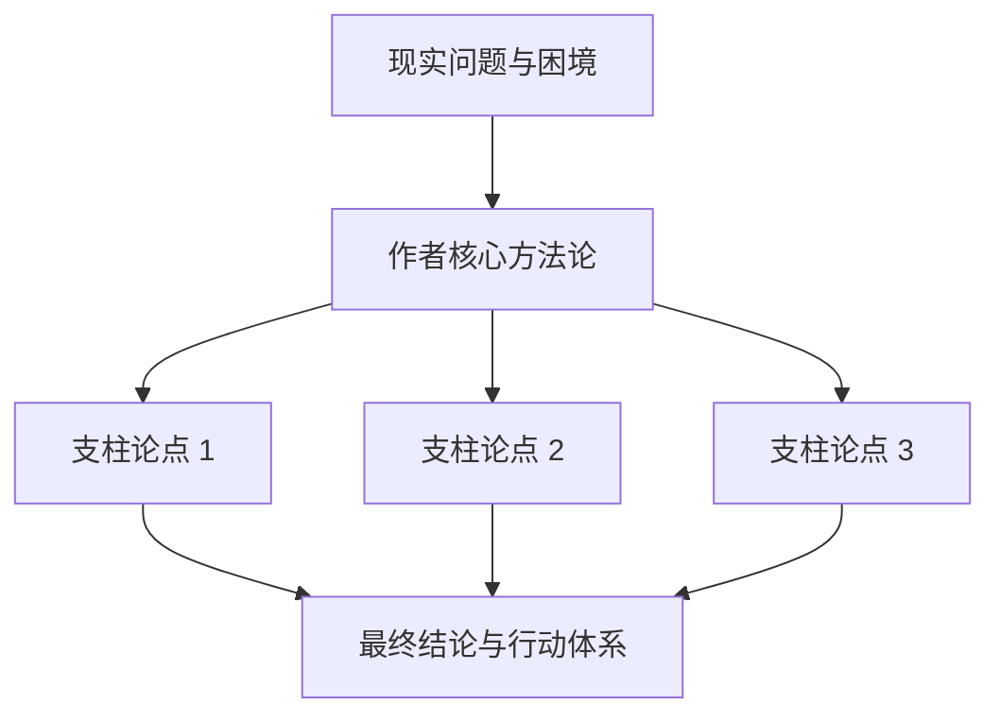

# 书籍与学术论文精读笔记模板 (Book & Paper Study Notes)

用于记录**经典技术名著、学术论文（Paper）、深度行业研究报告**的系统化精读。

---

## 模板结构

```markdown
---
title: "《【书名/论文名】》精读与行动转化笔记"
author: "【原作者】"
date: "YYYY-MM-DD"
category: "读书精读 / 论文研读"
tags: ["读书笔记", "论文解析", "知识体系"]
rating: "★★★★★"
---

# 《【书名/论文名】》精读萃取笔记

> [!NOTE]
> **全书/论文一句话核心论点（Core Thesis）**：
> 作者在本书中试图证明或提出：【一句话阐述核心观点】。



---

## 一、核心论证脉络 (Argument Structure)

### 1. 核心困境与现状
* 为什么现有的旧模式失效了？
* 作者识别出的根本矛盾是什么？

### 2. 核心模型与解法框架
* **模型名称**：【模型图/公式】
* **核心要素**：
  * 要素 1：...
  * 要素 2：...

---

## 二、金句提炼与心智刷新 (Mindset Shift)

| 传统思维 (Old Mindset) | 本书刷新认知的观点 (New Mindset) |
| :--- | :--- |
| 以为只要努力编码就能提高质量 | 架构的边界划分决定了系统复杂度的上限 |
| 以为测试只是上线前的检查工作 | 测试是重构与持续演进的设计工具 |

---

## 三、批判性思考与局限性 (Critical Thinking)

> [!WARNING]
> 任何方法论都有其适用边界。
> - **适用范围**：...
> - **局限与失效场景**：当处于【某些极端场景】时，该方法论可能会失效或带来负面影响。

---

## 四、落地转化行动清单 (Actionable Takeaways)

将书中的理念转化为现实中的具体行动：

- [ ] **行动项 1（立即执行）**：在当下的项目中...
- [ ] **行动项 2（中长期习惯）**：建立每周...
- [ ] **行动项 3（工具落地）**：引入...工具优化工作流。
```
