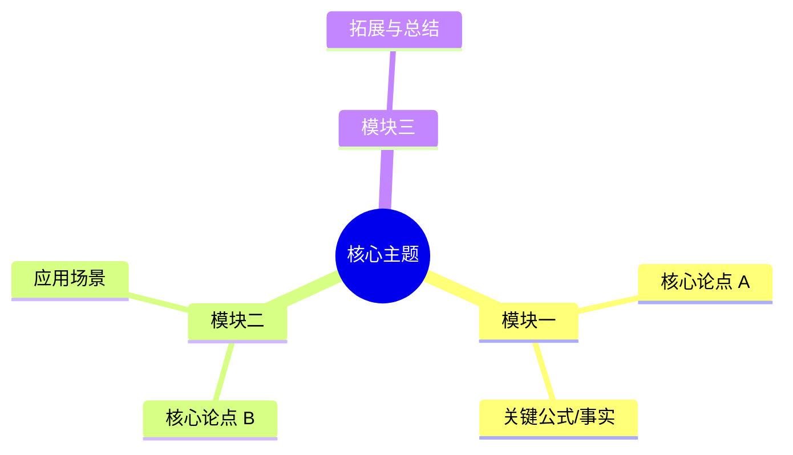

# 康奈尔笔记法标准模板 (Cornell Notes Method)

康奈尔笔记法（5R 笔记法：Record, Reduce, Recite, Reflect, Review）通过将页面分为**线索区（Cue）、主笔记区（Notes）、总结区（Summary）**，是最高效的主动复习与备考笔记系统。

---

## 模板结构

```markdown
---
title: "【主题名称】康奈尔系统学习笔记"
date: "YYYY-MM-DD"
category: "学科 / 模块"
tags: ["康奈尔笔记", "系统复习"]
---

# 【主题名称】康奈尔系统学习笔记

## 一、速览与全局框架 (Overview)



---

## 二、康奈尔交互笔记区 (Cue & Notes Matrix)

| 提示线索 (Cues / Questions) | 主笔记区 (Notes & Key Facts) |
| :--- | :--- |
| **Q1: 核心定义是什么？**<br/>*(关键词: 机制, 边界)* | 1. **定义**：...<br/>2. **核心特征**：<br/>  - 特征一：...<br/>  - 特征二：... |
| **Q2: 它与相似概念的区别？**<br/>*(关键词: 差异点)* | 1. 与 A 相比，它的优势在于...<br/>2. 权衡：牺牲了...换取了... |
| **Q3: 核心公式/推导逻辑？**<br/>*(关键词: 逻辑链)* | $$E = mc^2$$<br/>推导核心在于... |
| **Q4: 经典应用场景？**<br/>*(关键词: 实操, 案例)* | - 场景一：...<br/>- 场景二：... |

---

## 三、高频概念速查卡 (Key Concepts Glossary)

* **概念 A**：用一句话精炼解释。
* **概念 B**：用一句话精炼解释。
* **概念 C**：用一句话精炼解释。

---

## 四、底部总结区 (Summary & Action Items)

> [!IMPORTANT]
> **5 分钟精炼总结 (Summary)**：
> 用 2~3 段话总结全篇核心逻辑，解释这些知识点如何串联在一起。

### 行动转化清单 (Action Items / Next Steps)
- [ ] 1. 独立闭卷默写/复述 Cue 列的 4 个核心问题。
- [ ] 2. 结合实际项目/作业运行示例代码。
- [ ] 3. 标记未完全理解的模糊点：...
```
