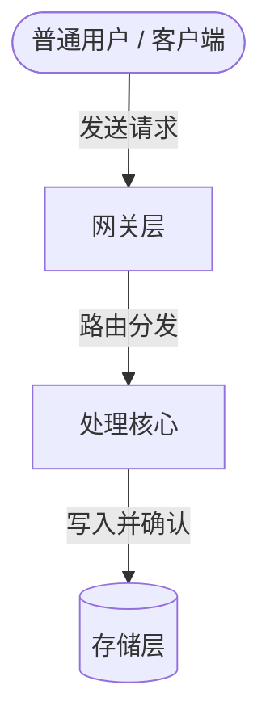

# 费曼学习法概念拆解模板 (Feynman Technique Template)

费曼学习法核心：**“如果你不能用最简单的语言向一个 10 岁小孩解释清楚，就说明你还没真正理解它。”**
用于攻克晦涩、抽象、容易陷入名词黑话的高难度概念。

---

## 模板结构

```markdown
---
title: "【晦涩概念名称】费曼极简通俗笔记"
date: "YYYY-MM-DD"
category: "深度概念攻坚"
tags: ["费曼学习法", "通俗化解释", "知识攻坚"]
---

# 【概念名称】：用大白话彻底讲透

> [!TIP]
> **黄金一句话比喻（10 岁小孩都能懂）**：
> “【概念名称】就像是生活中的【生动生活场景】，它的作用就是【核心目标】。”

---

## 一、生活化类比拆解 (Intuitive Analogy)

* **故事场景**：想象一个【生活故事，如快递分发/餐厅点餐/图书馆借书】...
* **角色映射**：
  * **现实中的角色 A** $\longleftrightarrow$ **技术中的概念 A**
  * **现实中的操作 B** $\longleftrightarrow$ **技术中的流程 B**
  * **现实中的冲突 C** $\longleftrightarrow$ **技术中的锁/并发/异常 C**

---

## 二、扒掉外衣：底层机制硬核拆解

在理解了直觉比喻后，还原其技术真相与底层逻辑：

1. **第一层：输入与触发条件**
2. **第二层：黑盒内部的核心计算与状态机**
3. **第三层：输出与副作用**



---

## 三、盲区侦测与知识补丁 (Knowledge Gap Fixes)

> [!WARNING]
> 记录自己在学习此概念时曾产生的误解与卡点：
> - **卡点 1（曾误以为）**：以为 A 是通过 B 实现的。
>   - **真相与拨乱反正**：实际上 A 是通过 C 实现的，因为 B 会带来...代价。
> - **卡点 2（容易混淆的边界）**：容易将 A 与 D 搞混。
>   - **核心鉴别标准**：看是否具备...特征。

---

## 四、费曼复述清单 (Teach-back Checklist)

尝试合上笔记，能否用自己的话回答以下问题：
- [ ] 1. 能否用 2 分钟不带任何专业黑话向朋友讲清楚它的作用？
- [ ] 2. 为什么发明者要这样设计，而不采用更简单的方案？
- [ ] 3. 如果去掉这个设计，整个系统在极端高并发下会发生什么雪崩？
```
