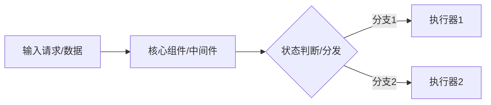

# 技术深度笔记标准模板 (Technical Deep Dive Template)

用于记录**框架机制、后端底层原理、分布式系统、算法与数据结构、性能调优**等技术主题。

---

## 模板结构

```markdown
---
title: "【技术名称/主题】核心原理与实战精要"
date: "YYYY-MM-DD"
category: "技术分类 / 子分类"
tags: ["标签1", "标签2", "架构"]
difficulty: "入门 / 中级 / 高级"
prerequisites: ["预备知识A", "预备知识B"]
---

# 【技术名称/主题】核心原理与实战精要

> [!NOTE]
> **TL;DR 核心要点速览**：
> - **解决了什么核心痛点**：一句话描述该技术诞生的背景和核心价值。
> - **核心运行机制**：关键数据结构 / 算法 / 交互流程。
> - **生产最佳实践**：最重要的一条设计或选型建议。



---

## 一、为什么需要它？（背景与痛点）

* **传统方案的局限**：在没有该技术前，我们面临什么瓶颈（如性能、并发、一致性、开发复杂度）？
* **核心设计哲学**：该技术做出了哪些权衡（Trade-offs，如 AP vs CP、以空间换时间）？

---

## 二、核心架构与原理解析

### 1. 概念与关键术语

| 术语名称 | 通俗定义 | 实际作用 |
| :--- | :--- | :--- |
| **术语 1** | 类似生活中... | 负责... |
| **术语 2** | 类似生活中... | 负责... |

### 2. 底层运行流程 (Step-by-Step)

1. **第一步（触发/接收）**：...
2. **第二步（计算/状态流转）**：...
3. **第三步（持久化/响应）**：...

---

## 三、核心代码与极简实战

> [!TIP]
> 仅保留核心关键路径，剔除无用的业务噪音代码。

```python
# 核心最小可运行示例
class KeyComponent:
    def __init__(self) -> None:
        self._state = {}

    def execute(self, payload: dict) -> bool:
        # 核心逻辑
        return True
```

---

## 四、生产避坑与反模式 (Anti-patterns)

| 常见误区 / 错误做法 | 潜在危害 | 生产推荐正解 |
| :--- | :--- | :--- |
| ❌ 做法 A | 内存泄漏 / 线程阻塞 | ✅ 正确做法 A |
| ❌ 做法 B | 数据不一致 | ✅ 正确做法 B |

---

## 五、自测问答卡片 (Flashcards / Active Recall)

- [ ] **Q1**：该技术的核心机制是什么？如果关闭/失效会导致什么后果？
- [ ] **Q2**：在什么业务场景下严禁使用该技术？
- [ ] **Q3**：如何监控该技术的健康指标（核心 Metrics）？
```
