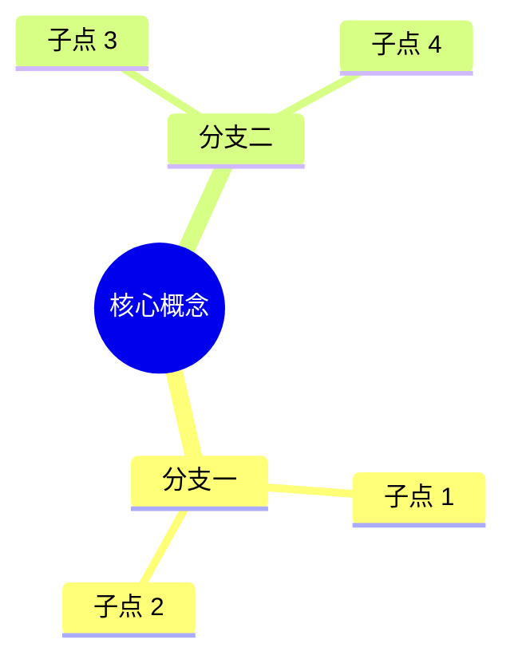
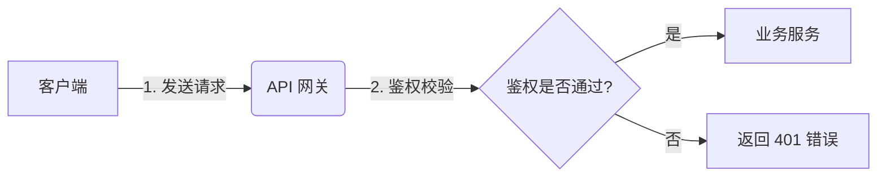
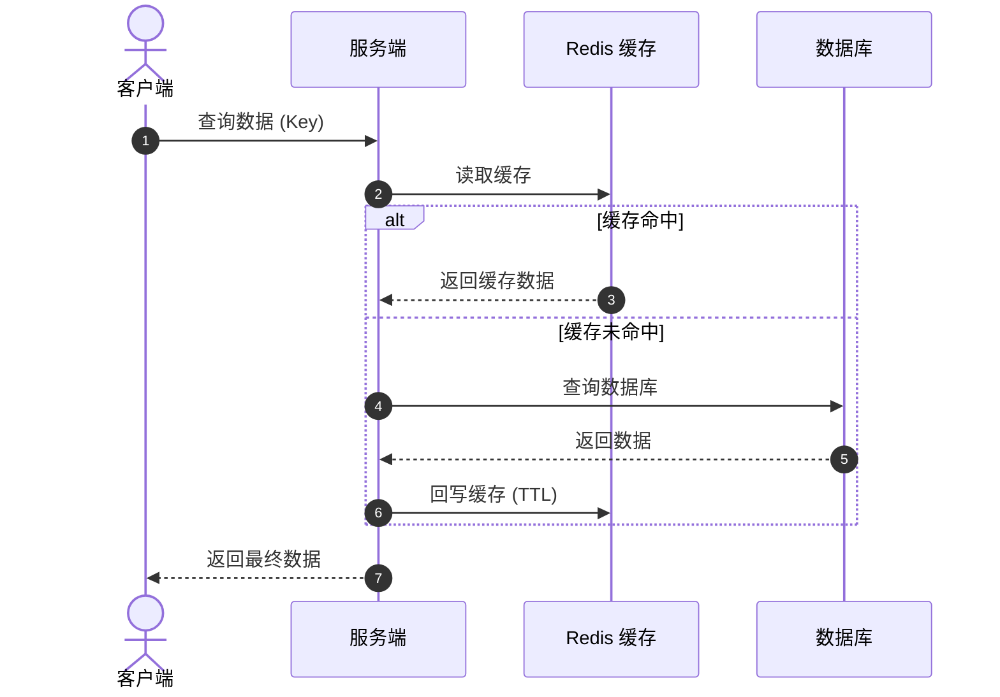

# 干净整洁排版美学与图表设计规范 (Typography & Diagrams)

为了确保学习笔记呈现出**极简、优雅、干净、赏心悦目**的视觉体验，必须遵循以下排版规范：

---

## 一、中英文混排与符号美学规范

1. **中英文与数字空格**：
   - ✅ `使用 Python 3.12 进行高并发处理，QPS 提升了 40%。`
   - ❌ `使用Python3.12进行高并发处理,QPS提升了40%。`
2. **标点符号纯正性**：
   - 中文句子使用全角标点（`，`、`。`、`？`、`！`、`：`、`；`、`「`、`」`）。
   - 英文代码与行内代码块内使用半角标点（`,`, `.`, `?`, `:`, `;`）。
3. **专业专有名词大小写**：
   - 严格使用官方标准命名：`JavaScript`（非 `javascript`）、`GitHub`（非 `github`）、`MySQL`（非 `mysql`）、`FastAPI`（非 `fastapi`）、`Redis`（非 `redis`）。

---

## 二、标准 GitHub Alerts 警告框规范

使用标准 Callout 强调关键信息，禁止连续滥用超过 2 个：

```markdown
> [!NOTE]
> 背景上下文、前置知识、TL;DR 摘要

> [!TIP]
> 技巧建议、更优解法、生活化通俗类比

> [!IMPORTANT]
> 核心定义、必须掌握的关键定理、核心结论

> [!WARNING]
> 常见误区、踩坑经验、反模式 (Anti-pattern)

> [!CAUTION]
> 严重风险、可能导致线上事故或数据丢失的危险操作
```

---

## 三、Mermaid 图表设计规范

笔记中尽量避免干巴巴的文字流程，使用精巧的 Mermaid 图表：

### 1. 思维导图 (Mindmap)


### 2. 交互流程图 (Graph TD / LR)


### 3. 时序图 (Sequence Diagram)


---

## 四、数学公式规范 (LaTeX Math)

- **行内公式**：使用 `\(E=mc^2\)` 或 `$E=mc^2$`。
- **块级公式**：独占一行，使用 `\[...\]` 或 `$$...$$`：

\[
\text{Precision} = \frac{TP}{TP + FP}, \quad \text{Recall} = \frac{TP}{TP + FN}
\]
