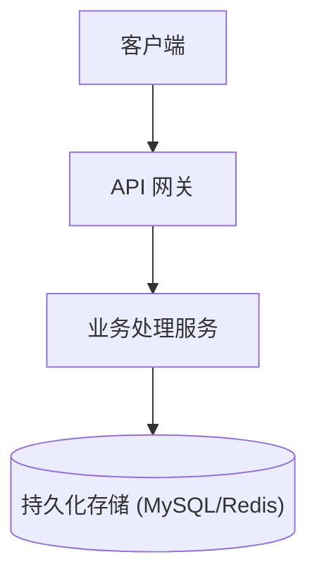
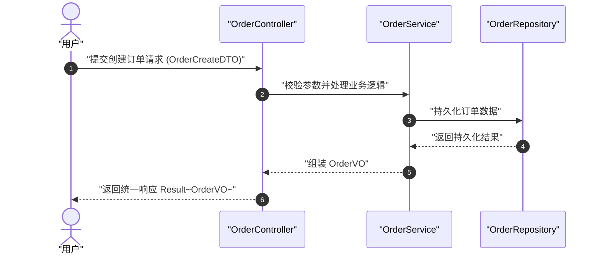
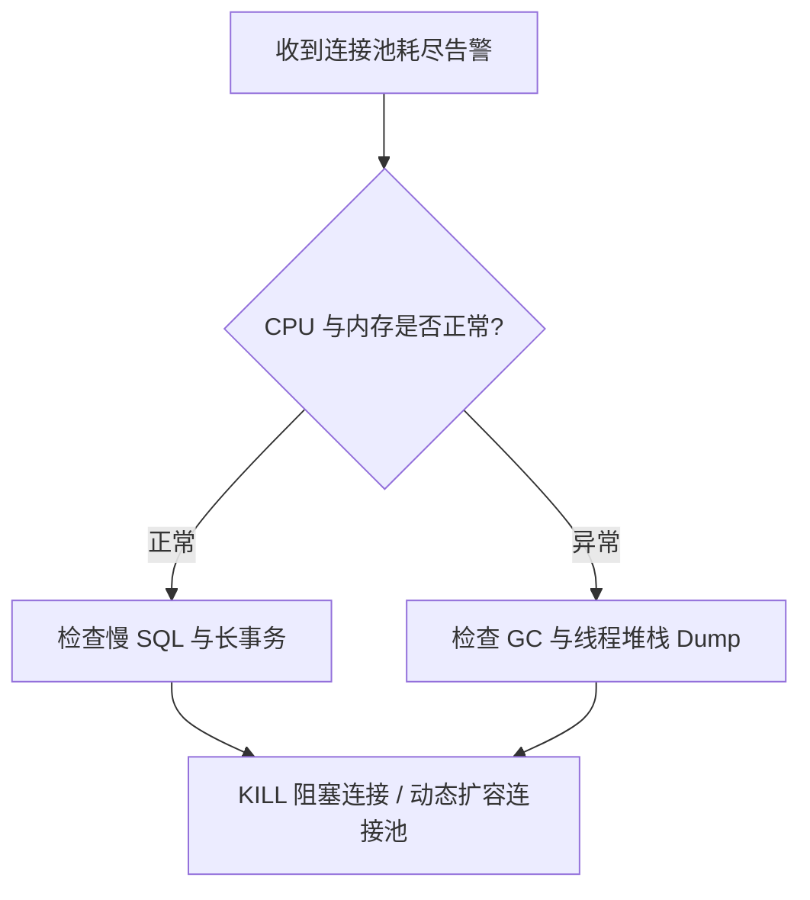

# 技术与学习文档编写指南 (Tech & Study Docs)

## 概述 (Overview)

技术文档与学习笔记的核心目标是**以最低的阅读成本传递最高的信息密度**。
杜绝冗长空洞的叙述，坚持“**结论先行、代码先行、图表直观、规约严谨、Mermaid 零解析错误**”。

---

## 适用场景 (When to Use)

- 撰写技术学习笔记、知识体系梳理与速查手册 (Cheat Sheet)
- 编写技术方案设计文档、架构设计与 ADR (架构决策记录)
- 编写 API 接口文档、SDK/组件使用指南与快速上手 (QuickStart)
- 整理生产环境排错指南 (Troubleshooting / Runbook) 与复盘文档
- 结合阿里巴巴开发规范对工程代码注释及文档进行标准化重构

**不适用场景 (When NOT to Use):**
- 纯代码重构且无公共接口变动时无需编写外部文档。
- 简短的一句话答疑或一次性临时脚本。

---

## 四象限文档架构 (Diátaxis Framework)

编写前先明确文档的定位，避免不同类型的目标混杂：

| 类型 | 目标受众状态 | 核心导向 | 内容特征 | 典型示例 |
| :--- | :--- | :--- | :--- | :--- |
| **教程 (Tutorial)** | 学习者 (从零开始) | 学习导向 (Learning-oriented) | 步骤递进、可运行的端到端示例、少理论多实操 | 3分钟搭建 SpringBoot 工程 |
| **操作指南 (How-to Guide)** | 开发者 (解决具体问题) | 目标导向 (Task-oriented) | 直奔主题、步骤清单、前置条件明确、无冗余原理解释 | 如何配置 Redis 分布式锁 |
| **参考手册 (Reference)** | 开发者 (查询具体细节) | 信息导向 (Information-oriented) | 严谨、准确、分类索引、参数/返回值/异常说明 | API 接口列表、配置项大全 |
| **深度解析 (Explanation)** | 架构师/进阶者 (理解底层设计) | 理解导向 (Understanding-oriented) | 核心概念、架构图、权衡考量 (Trade-offs)、设计背景 | 并发控制模型解析与选型对比 |

---

## 核心写作原则 (Core Principles)

1. **结论与总结先行 (BLUF - Bottom Line Up Front)**
   - 每一个章节开头用 1~2 句话直接给出结论或核心定义。
   - 避免冗长的心路历程和历史回顾。

2. **高信噪比与表格化 (High Signal-to-Noise Ratio)**
   - 能用表格对比的不用多段文字；能用列表的不用长句。
   - 剔除“正如我们所知”、“众所周知”、“非常重要的是”等无效修饰词。

3. **图表优先 (Visual First)**
   - 架构关系、业务流程、状态机必须优先使用 Mermaid 图表直观展示。

4. **对齐阿里开发规约 (Alibaba Standard Compliance)**
   - **命名规范**：包名全小写、类名 UpperCamelCase、方法/变量 lowerCamelCase、常量全部大写并用下划线隔开。
   - **JavaDoc 规约**：类、类属性、接口方法必须有完整的 Javadoc 注释（含 `@param`, `@return`, `@throws` 说明）。
   - **异常与日志**：在文档中明确标出错误码含义、异常抛出场景及防御性编程边界。
   - **领域模型划分**：文档中清晰区分 DO (Data Object)、DTO (Data Transfer Object)、VO (View Object)、BO (Business Object)。

---

## Mermaid 图表防报错与优化规约 (Mermaid Zero-Error Guidelines)

> [!IMPORTANT]
> 为避免出现 `Error parsing Mermaid diagram!` 解析错误，生成所有 Mermaid 图表必须严格遵循以下防御性语法规则：

### 1. 节点文本强制双引号包裹 (Always Quote Node Labels)
凡是包含**空格、括号 `() [] {}`、中文标点、冒号 `:`、斜杠 `/`、问号 `?`、下划线 `_`、连字符 `-`** 等字符的文本，**必须用英文双引号 `""` 包裹**。
- ❌ **错误**：`A[网关(Spring Cloud Gateway)]`、`B{CPU/内存是否正常?}`、`DB[(MySQL 8.0 主库)]`
- ✅ **正确**：`A["网关 (Spring Cloud Gateway)"]`、`B{"CPU/内存是否正常?"}`、`DB[("MySQL 8.0 主库")]`

### 2. 避免保留字冲突 (Avoid Keyword Collision for Node IDs)
节点 ID 严禁使用 Mermaid 关键字（如 `end`, `subgraph`, `graph`, `class`, `style`, `click`, `call`, `default`）。
- ❌ **错误**：`end[流程结束]`
- ✅ **正确**：`finishNode["流程结束"]` 或 `node_end["流程结束"]`

### 3. 特殊符号与泛型转义 (Escape Generics & Angle Brackets)
严禁在节点文本内直接书写 `<` 和 `>`，否则解析器会将其误认为 HTML 标签而崩溃。
- ❌ **错误**：`Service["处理 List<OrderDTO>"]`
- ✅ **正确**：`Service["处理 List~OrderDTO~"]` 或 `Service["处理 List&lt;OrderDTO&gt;"]`

### 4. 连线与标签规范 (Connection & Condition Syntax)
- 流程图分支判断标签需用竖线包裹纯文本：`B -->|"是"| C["继续处理"]` 或 `B -->|是| C["继续处理"]`。
- 严禁在连线标签中使用未转义的特殊字符。

### 5. 子图与时序图严谨语法 (Subgraph & Sequence Rules)
- `subgraph` 建议使用标准结构：`subgraph SubCluster ["子系统名称"] ... end`，必须有对应的 `end` 闭合。
- 时序图中消息文本严禁连续多个未包裹冒号，`autonumber` 单独成行。

---

## 常用高频文档模板 (Standard Templates)

### 模板 1：技术学习笔记 / 知识速查 (Study Note & Cheat Sheet)

```markdown
# [技术/组件名称] 核心速查与笔记

## 1. 一句话定位 (Core Essence)
> **本质**：[一句话说明它是解决什么问题的核心工具/模式]
> **核心价值/优势**：[性能 / 解耦 / 事务保证等关键特性]

## 2. 核心概念与架构 (Architecture & Key Concepts)

- **核心组件 A**：职责与关键机制
- **核心组件 B**：职责与关键机制

## 3. 极简实战 / 最小可用示例 (Minimal Working Example)
```java
// 关键配置或调用代码（带阿里规约注释）
public class DemoService {
    /**
     * 执行核心业务处理
     *
     * @param request 请求参数对象，非空
     * @return 处理结果包装类
     */
    public Result<String> execute(RequestDTO request) {
        // 核心逻辑...
    }
}
```

## 4. 关键配置与常用命令/API (Cheat Sheet)
| 配置项 / 命令 | 默认值 | 作用说明 | 推荐生产值 / 最佳实践 |
| :--- | :--- | :--- | :--- |
| `timeout_ms` | `1000` | 超时时间阈值 | `3000` (结合熔断器配置) |

## 5. 避坑指南与常见问题 (Pitfalls & FAQ)
- ⚠️ **踩坑点 1**：[现象] -> **根本原因**：[原因] -> **正确解法**：[代码/配置修复方案]
- ⚠️ **踩坑点 2**：[并发/内存/事务失效场景及规避方法]
```

---

### 模板 2：技术方案与架构设计文档 (Tech Spec & Design)

```markdown
# [项目/功能名称] 技术方案设计

## 1. 背景与目标 (Context & Goals)
- **业务背景**：解决当前系统在 [X场景] 下的 [Y痛点]。
- **核心目标**：
  - [目标 1：如 QPS 提升至 10,000 / 延迟降至 50ms 以内]
  - [目标 2：满足 ACID 事务一致性]
- **非目标 (Non-Goals)**：[明确本次迭代不涉及的范围]

## 2. 架构设计 (System Architecture)


## 3. 详细设计 (Detailed Design)

### 3.1 领域模型与接口契约 (Domain Model & APIs)
| 接口路径 | 请求方式 | 入参 DTO | 返回 VO | 权限/限流 |
| :--- | :--- | :--- | :--- | :--- |
| `/api/v1/order/create` | POST | `OrderCreateDTO` | `OrderVO` | 需登录 / 100 QPS |

### 3.2 数据模型变更 (Data Schema)
```sql
-- 严格遵守阿里数据库规约：小写下划线、主键id、gmt_create/gmt_modified
CREATE TABLE `tb_trade_order` (
  `id` bigint unsigned NOT NULL AUTO_INCREMENT COMMENT '主键ID',
  `order_sn` varchar(64) NOT NULL DEFAULT '' COMMENT '业务订单号',
  `user_id` bigint unsigned NOT NULL DEFAULT '0' COMMENT '用户ID',
  `status` tinyint NOT NULL DEFAULT '0' COMMENT '状态: 0-待支付, 1-已支付, 2-已取消',
  `gmt_create` datetime NOT NULL DEFAULT CURRENT_TIMESTAMP COMMENT '创建时间',
  `gmt_modified` datetime NOT NULL DEFAULT CURRENT_TIMESTAMP ON UPDATE CURRENT_TIMESTAMP COMMENT '修改时间',
  PRIMARY KEY (`id`),
  UNIQUE KEY `uk_order_sn` (`order_sn`),
  KEY `idx_user_status` (`user_id`, `status`)
) ENGINE=InnoDB DEFAULT CHARSET=utf8mb4 COMMENT='交易订单表';
```

## 4. 权衡与决策 (Trade-offs & ADR)
- **方案 A (最终选定)**：[简述方案 + 为什么选择]
- **方案 B (已否决)**：[简述方案 + 为何不适用]

## 5. 风险与降级预案 (Risks & Fallbacks)
| 风险场景 | 监控指标 | 应急降级策略 |
| :--- | :--- | :--- |
| 第三方接口超时 | P99 延迟 > 500ms | 自动降级为本地缓存并异步重试 |
```

---

### 模板 3：排错与运维手册 (Troubleshooting Runbook)

```markdown
# [故障名称/错误码] 排错与应急指南

## 1. 现象特征 (Symptoms)
- **报警信息**：`ErrorCode: 50032 [DB_CONNECTION_POOL_EXHAUSTED]`
- **影响范围**：[支付模块 / 订单查询受阻]

## 2. 快速排查步骤 (Quick Diagnostic Flow)


## 3. 应急止血措施 (Immediate Mitigation)
1. **执行限流**：通过配置中心下发限流阈值至 500 QPS。
2. **连接释放**：执行运维指令重启或清理阻塞线程。

## 4. 根因分析与长期修复 (Root Cause & Fix)
- **根因**：[详细原因分析]
- **修复方案**：[代码优化/索引添加/超时时间调整]
```

---

## 质量自检清单 (Quality Checklist)

在交付文档前，逐项核对：
- [ ] **结构清晰**：是否有明确的标题层级（H1、H2、H3）与目录索引？
- [ ] **重点突出**：第一段是否直接写明结论与核心价值？
- [ ] **Mermaid 语法合规**：
  - [ ] 所有包含特殊字符/括号/中文的节点是否均使用 `""` 双引号包裹？
  - [ ] 是否排除了 `end`, `class`, `style` 等保留字作为节点 ID？
  - [ ] 是否避免了未转义的 HTML 标签或泛型 `<T>`（改为 `~T~` 或 `&lt;T&gt;`）？
- [ ] **代码规范**：示例代码是否符合阿里开发规范，且语法高亮完整？
- [ ] **参数详尽**：表格中的字段名、类型、默认值、必填项是否准确？
- [ ] **去冗余化**：是否已剔除全部空洞无意义的修饰词与过长寒暄？
